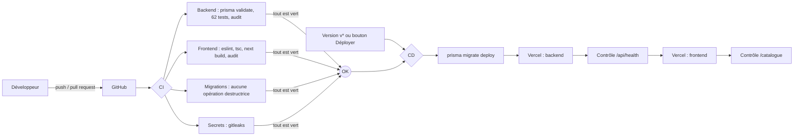

# CI/CD d'Afro-food

Le projet est livré par **deux pipelines équivalents**, qui exécutent les mêmes contrôles :

| | GitHub Actions | Jenkins |
|---|---|---|
| Fichier | `.github/workflows/ci.yml` et `deploy.yml` | `Jenkinsfile` |
| Où ça tourne | Serveurs GitHub (aucun serveur à gérer) | Jenkins en Docker (`ci/jenkins/`) |
| Rôle | Pipeline de référence, déclenché à chaque push | Pipeline « as code » auto-hébergé |

## Vue d'ensemble



## Ce qui est contrôlé à chaque changement
- **Backend** : schéma Prisma valide, 62 tests unitaires (`node --test`), audit des dépendances (niveau *high*).
- **Frontend** : ESLint (0 erreur), TypeScript strict, build de production Next.js, audit des dépendances.
- **Migrations** : refus des `DROP TABLE/COLUMN`, `TRUNCATE` ajoutés sans validation explicite (`scripts/verifier-migrations.sh`).
- **Secrets** : détection de clés laissées dans le code (gitleaks).

## Déploiement contrôlé
- Jamais à chaque push : uniquement sur une **version** (`git tag v1.0.0 && git push --tags`) ou à la demande (*Actions → Déploiement → Run workflow*).
- Les vérifications doivent être **vertes**.
- Ordre : migrations additives → backend → contrôle de santé → frontend → contrôle de santé.
- Environnement GitHub `production` : permet d'exiger une validation manuelle avant déploiement (Settings → Environments → Required reviewers).

## Mise en route GitHub Actions
1. Vercel → *Settings → Tokens* : créer un jeton. GitHub → *Settings → Secrets and variables → Actions* :
   - Secrets : `VERCEL_TOKEN`, `DATABASE_URL_DIRECT` (URL Neon directe, sans `-pooler`).
   - Variables : `VERCEL_ORG_ID`, `VERCEL_BACKEND_PROJECT_ID`, `VERCEL_FRONTEND_PROJECT_ID`, `BACKEND_URL`, `FRONTEND_URL`.
2. Désactiver le déploiement automatique de Vercel à chaque push (`git.deploymentEnabled: false` dans `vercel.json`), pour ne déployer que par le pipeline.

## Mise en route Jenkins
```bash
cd ci/jenkins
cp .env.example .env        # renseigner mot de passe admin, VERCEL_TOKEN, DATABASE_URL_DIRECT
docker compose up -d --build
# http://localhost:8080 — le job « afro-food » (multibranch GitHub) est créé automatiquement
```
- Jenkins est configuré **entièrement en code** (`jenkins.yaml`, plugins figés dans `plugins.txt`) : comptes, droits, identifiants, job.
- Le contrôleur n'exécute aucun build (`numExecutors: 0`) : chaque étape tourne dans un conteneur `node:24` jetable.
- Pour recevoir les webhooks de GitHub, Jenkins doit être joignable depuis Internet (VPS + HTTPS, ou tunnel en test).
- Le déploiement Jenkins demande une confirmation manuelle (`input`) et n'a lieu que sur `main` avec le paramètre `DEPLOYER`.

## Compétences démontrées (pour le CV)
- Conception d'un pipeline **CI/CD** complet sur deux outils (**GitHub Actions** et **Jenkins**) : lint, typage, tests, build, audit de sécurité, détection de secrets, déploiement et vérification post-déploiement.
- **Infrastructure as code** : Jenkins configuré par `Jenkins Configuration as Code`, plugins versionnés, conteneurs Docker éphémères, secrets hors du dépôt.
- **Déploiement sûr** : migrations de base de données contrôlées (garde-fou contre les opérations destructrices), environnement protégé, vérifications de santé automatiques, déclenchement par version.
- Bonnes pratiques : moindre privilège (`permissions: contents: read`), annulation des exécutions redondantes, cache des dépendances, délais d'expiration (timeouts).
